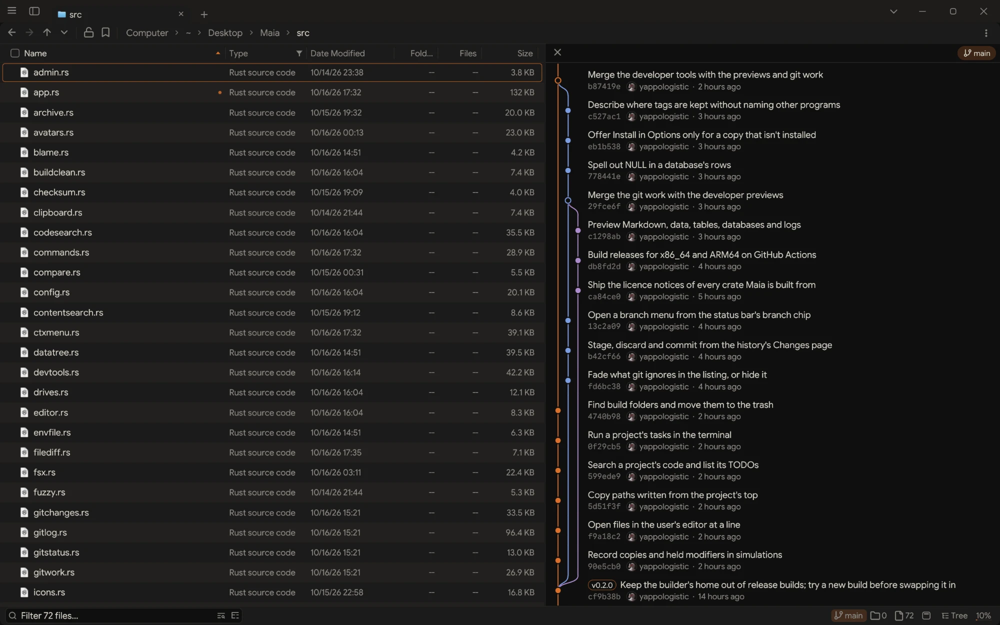

# Maia

A fast, keyboard-first file manager for Linux, written in Rust with egui. One binary
of about 4 MB, drawn on the GPU, with split panels, tabs, live filtering, previews and
background file operations.



<p align="center">
  <a href="https://buymeacoffee.com/e_gurl">
    
  </a>
</p>

## Install

You need a Wayland or X11 desktop with OpenGL. The releases have builds for x86_64
and ARM64 (`maia-linux-aarch64`) that run on glibc 2.35 or newer, so Ubuntu 22.04,
Debian 12, Fedora 36 and anything later:

```bash
curl -LO https://github.com/yappologistic/Maia/releases/latest/download/maia-linux-x86_64
chmod +x maia-linux-x86_64
./maia-linux-x86_64 --install
```

To build it yourself you need Rust (1.88 or newer):

```bash
git clone https://github.com/yappologistic/Maia.git
cd Maia
cargo build --release
./target/release/maia --install
```

`--install` copies the binary to `~/.local/bin/maia` and adds Maia to your app
launcher. To make it the file manager other apps open folders with, turn on
Options > Startup & system > Default file manager (or run `maia --set-default`);
turning it off gives folders back to the one you had before. `maia --uninstall`
removes the launcher entry and binary again (your settings stay).

While Maia is open, opening a folder from another app or the terminal shows it as
a new tab in that window. `maia --window PATH` always opens a window of its own.

`./build-dist.sh` makes the smallest build (about 3.1 MB instead of 4.8). It needs a
nightly toolchain with `rust-src` and the `lld` linker.

These are optional. Maia works without them and uses them when they are there:

| Program | Used for |
|---|---|
| `bsdtar` (libarchive) | opening zip, tar, 7z, rar and iso archives like folders; extracting and compressing |
| `7z` | password-protected 7z archives (and quicker password checks for zip) |
| `gio` (GVFS) | network places (smb, sftp, ftp, WebDAV) and phones over MTP |
| `pkexec` (polkit) | retrying a refused copy, move, delete or rename as administrator |
| `git` | change marks on files in git repositories, their history and blame, staging and committing, branches and the stash |
| `sqlite3` | the tables and first rows of SQLite databases, read-only, in the inspector |
| `ollama` | search by meaning, if you turn it on (it fetches a ~860 MB model only when you ask); `ollama-vulkan` lets it use the graphics card |
| `ffmpeg`, `ffprobe`, `ffplay` | video and audio previews and thumbnails |
| `pdfinfo`, `pdftoppm` (poppler) | PDF pages in the inspector |
| `soffice` (LibreOffice) | Word, Excel, PowerPoint and OpenDocument files in the inspector, with poppler |
| `udisksctl` (udisks2), `lsblk` | mounting, unmounting and ejecting drives |
| desktop thumbnailers | thumbnails for other formats, shared with your other apps |

## Use

```bash
maia [PATH...]
```

Start typing to filter the folder you are in. The filter also takes conditions such
as `size>100M`, `modified<7d`, `created:today` or `tag:red`. Some keys to start with:

| Action | Keys |
|---|---|
| Go to a place or path | Ctrl+P, Ctrl+L |
| Every command, and their hotkeys | Ctrl+Shift+P |
| Back, forward, up | Alt+Left, Alt+Right, Backspace |
| New tab, close tab, reopen | Ctrl+T, Ctrl+W, Ctrl+Shift+T |
| Split right, split below | Ctrl+Shift+S, Ctrl+S |
| Switch panel | Tab |
| Preview | Space |
| Every file below this folder in one list | Ctrl+E |
| Rename (several files at once) | F2 |
| New folder | Ctrl+Shift+N |
| Trash, delete | Delete, Shift+Delete |
| Undo | Ctrl+Z |
| Options | Ctrl+, |

Every binding can be changed from the command palette.

An archive opens like a folder; right-click it for Extract Here, or right-click files
for Compress. Set As Wallpaper, in a picture's menu, works on GNOME, KDE, XFCE,
Cinnamon, MATE, sway, Hyprland (with hyprpaper or swww) and Noctalia. Connect To Server (in the menu, or type an `smb://`, `sftp://` or
`ftp://` address into Go To) opens network shares, which then stay in the sidebar's
Network section. Right-click files for Tags to give them colour labels or named tags
(kept on the files as extended attributes, which other programs can read). In a git
repository, the branch name in the status bar opens a menu: the commit history, the
branches to switch to or create, the stash and the other work trees. In the history a
commit shows its files with their diffs, and right-clicking a file shows the commits
that changed it. Changes, above the commits, stages files or single hunks, discards
(into the stash, or the trash for a new file) and commits; Ctrl+Enter commits. Files
git ignores are drawn faded, or hidden (Options, Git), and Add to .gitignore in a file's
menu ignores it or every file with its extension. Copy as gives files as Markdown code
blocks under their paths, or as links to them on GitHub, GitLab or Codeberg at the
commit checked out, and Open Web Link opens that page. Compare Files, in the menu of two
selected files, shows how they differ in the inspector. Maia never pushes.

The inspector renders Markdown, shows JSON, TOML and YAML as trees you fold with the
arrow keys, and CSV and TSV as tables; its toolbar switches any of them to the text as
written. Values in `.env` files stay hidden until clicked. A log can be followed as it
grows and filtered to the lines you want, and Blame puts who last changed each line
of a committed file beside it; clicking a line opens that commit.

Ctrl+K finds files and folders anywhere in your home folder by name, as you type.
With search by meaning turned on, it also finds documents, PDFs and pictures by what
they are about or show ("a dog on the beach", "the lease clause about pets"), and words
you type that are in a file's name or text count too. Only what clearly stands out is
listed, weaker matches folded under it. That is off until you turn it on in Options,
and then reads only the folders you list there (not code or data files), using a small
model running on your computer through Ollama. The first read of a large folder takes a
while; after that only new and changed files are read. With a graphics card and
`ollama-vulkan` installed it is several times faster. Pictures wait while a laptop runs
on its battery.

Updates come from this repository's releases. In Options, Startup & system, Check for
updates asks GitHub whether a newer Maia is out; Update downloads it, checks it against
the release's checksum and puts it in place of the installed one, and Restart opens it.
`maia --update` does the same from a terminal. Maia never checks on its own. The
updater runs a new build once before it swaps anything in, so a build that can't run
on your system is left out and Maia stays as it is. One installed by a package manager
is updated there.

Settings live in `~/.config/maia/config.json`, bookmarks and layouts in
`~/.local/share/maia/userdata.json`.

## When something goes wrong

Maia writes a line to `~/.local/state/maia/crash.log` when it crashes or cannot
start, and shows a notification if it fails before the window opens. Run it from a
terminal to see the same messages. Include that log when you report a problem.

## Development

```bash
cargo test           # unit tests
tools/sim.sh         # simulated users, in a sandbox (needs bubblewrap)
tools/window.sh      # a real window driven through a pipe, for checking by eye
```

## License

GPL-3.0-or-later. See [LICENSE](LICENSE). The bundled fonts and icons keep their own
licenses, in `assets/`, and so do the Rust crates Maia is built from:
[assets/THIRD-PARTY-NOTICES.txt](assets/THIRD-PARTY-NOTICES.txt) lists each with its
license text (`tools/notices.py` writes it).
