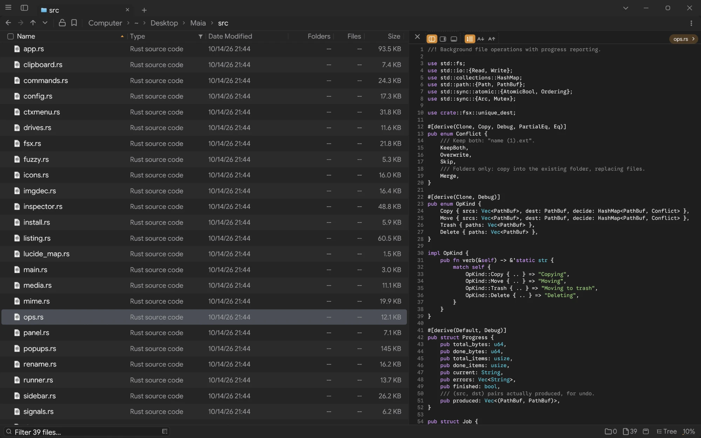

# Maia

A fast, keyboard-first file manager for Linux, written in Rust with egui. One binary
under 3 MB, drawn on the GPU, with split panels, tabs, live filtering, previews and
background file operations.



## Install

You need Rust (1.88 or newer) and a Wayland or X11 desktop with OpenGL.

```bash
git clone https://github.com/yappologistic/Maia.git
cd Maia
cargo build --release
./target/release/maia --install
```

`--install` copies the binary to `~/.local/bin/maia` and adds Maia to your app
launcher. `maia --set-default` makes it the file manager other apps open folders
with, and `maia --uninstall` removes both again (your settings stay).

`./build-dist.sh` makes the smallest build (about 3 MB instead of 4.6). It needs a
nightly toolchain with `rust-src` and the `lld` linker.

These are optional. Maia works without them and uses them when they are there:

| Program | Used for |
|---|---|
| `ffmpeg`, `ffprobe`, `ffplay` | video and audio previews and thumbnails |
| `pdfinfo`, `pdftoppm` (poppler) | PDF pages in the inspector |
| `udisksctl` (udisks2), `lsblk` | mounting, unmounting and ejecting drives |
| desktop thumbnailers | thumbnails for other formats, shared with your other apps |

## Use

```bash
maia [PATH...]
```

Start typing to filter the folder you are in. Some keys to start with:

| Action | Keys |
|---|---|
| Go to a place or path | Ctrl+P, Ctrl+L |
| Every command, and their hotkeys | Ctrl+Shift+P |
| Back, forward, up | Alt+Left, Alt+Right, Backspace |
| New tab, close tab, reopen | Ctrl+T, Ctrl+W, Ctrl+Shift+T |
| Split right, split below | Ctrl+Shift+S, Ctrl+S |
| Switch panel | Tab |
| Preview | Space |
| Every file below this folder in one list | Ctrl+E |
| Rename (several files at once) | F2 |
| New folder | Ctrl+Shift+N |
| Trash, delete | Delete, Shift+Delete |
| Undo | Ctrl+Z |
| Options | Ctrl+, |

Every binding can be changed from the command palette.

Settings live in `~/.config/maia/config.json`, bookmarks and layouts in
`~/.local/share/maia/userdata.json`.

## When something goes wrong

Maia writes a line to `~/.local/state/maia/crash.log` when it crashes or cannot
start, and shows a notification if it fails before the window opens. Run it from a
terminal to see the same messages. Include that log when you report a problem.

## Development

```bash
cargo test           # unit tests
tools/sim.sh         # simulated users, in a sandbox (needs bubblewrap)
tools/window.sh      # a real window driven through a pipe, for checking by eye
```

## License

GPL-3.0-or-later. See [LICENSE](LICENSE). The bundled fonts and icons keep their own
licenses, in `assets/`.
